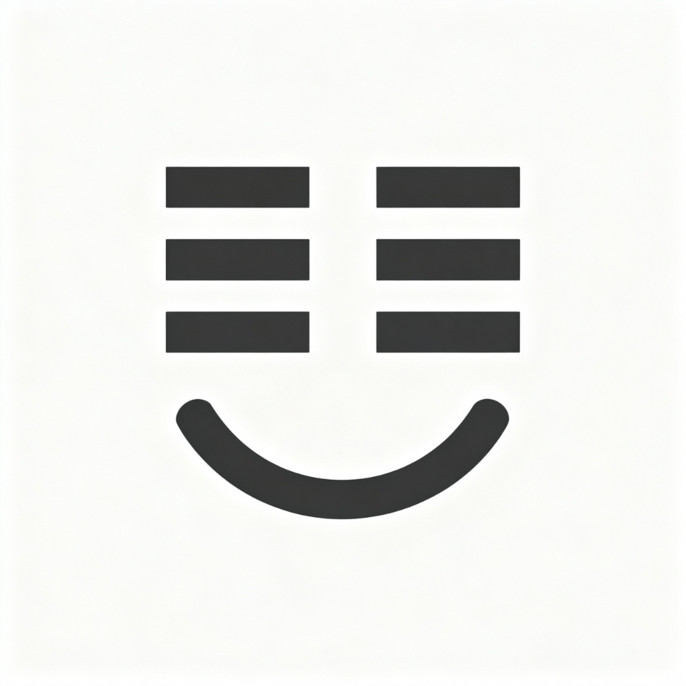
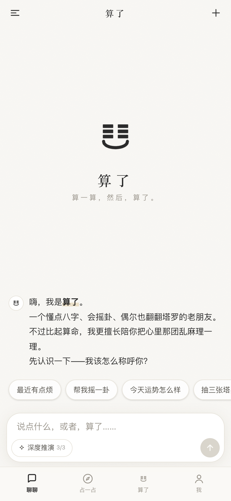
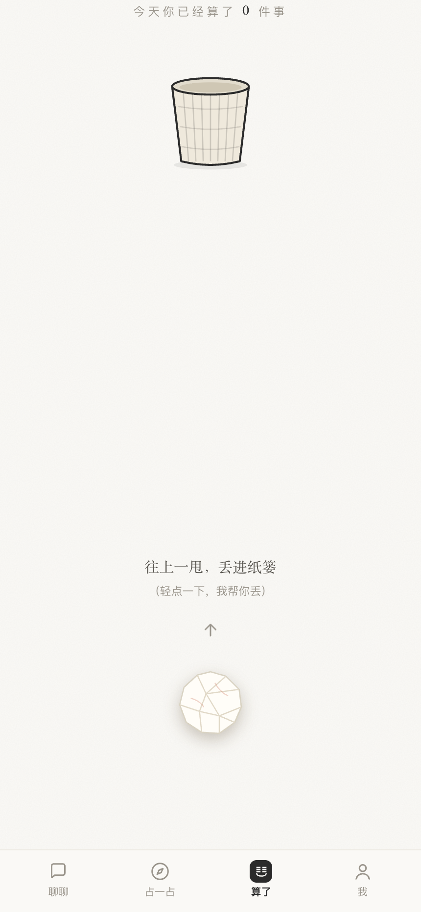
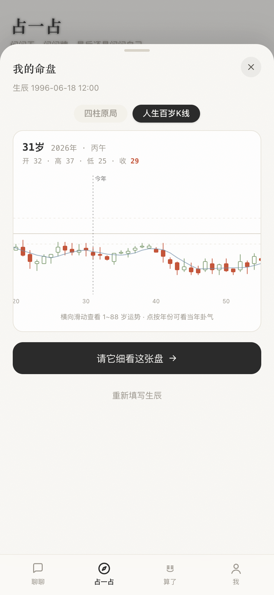
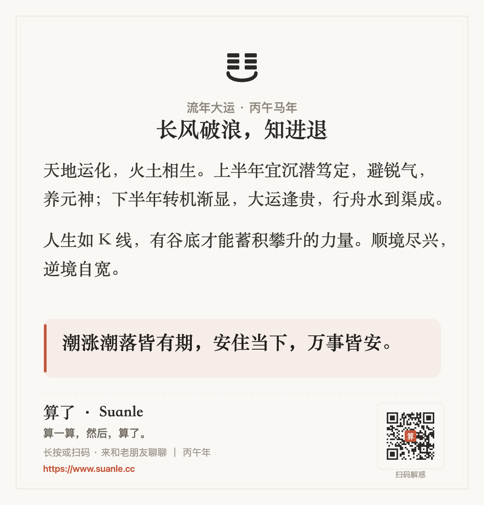
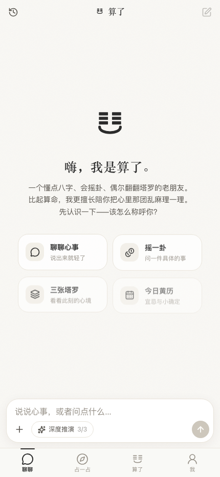
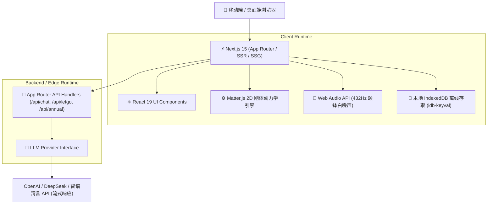

<p align="center">
  <a href="https://github.com/Evan-Joseph/suanle">
    
  </a>
</p>

<h1 align="center">算了 · Suanle</h1>

<p align="center">
  <b>算一算，然后，算了。</b><br>
  基于 Next.js 15 与大语言模型的沉浸式 AI 互动决策与心理疗愈 Web 应用
</p>

<p align="center">
  
  
  
  
  
  
  
  
</p>

---

## 🎬 动态交互与宣传分镜演示 (Live Demo & Motion Preview)

<p align="center">
  
  
</p>

<p align="center">
  <i>左图：移动端四模块平滑转场与实时漫游 | 右图：三枚铜钱 WebGL 物理刚体碰撞摇卦</i>
</p>

---

## 🌟 源码对齐的核心四大功能模块 (Core Modules in Code)

依据 `src/components/AppShell.tsx` 与各子页面组件的真实实现，系统由以下四大核心板块驱动：

| 1. 聊聊 (`ChatView.tsx`) | 2. 占一占 (`ExploreView.tsx`) |
| :---: | :---: |
|  |  |
| **老友式心理抚慰对谈**：多轮上下文追踪、会话抽屉管理与预设破冰锦囊，融合东方传统智慧与现代心理疗愈。 | **综合术数推理矩阵**：<br>• 今日黄历简析 (`AlmanacCard`)<br>• 问一件事：六爻铜钱起卦 (`CoinCaster`)、塔罗三张牌 (`TarotPicker`)<br>• 看看自己：八字四柱、紫微十二宫排盘 |

| 3. 算了 (`LetGoView.tsx`) | 4. 流年年度盘 (`Annual.tsx`) |
| :---: | :---: |
|  |  |
| **心事物理粉碎沙盒**：书写烦恼心事，生成纸团揉碎剔除；结合 **Matter.js 2D 刚体动力学** 与 **432Hz 颂钵声学共振**，完成情绪放下。 | **十二个月运势平滑曲线**：基于贝塞尔样条算法 (`smoothPath`) 绘制全年流年十二个月能量起伏与每段时期的行动指引。 |

<details>
<summary>📇 <b>点击展开查看：年鉴艺术卡片与移动端首屏 (Click to view cards & home)</b></summary>
<br>
<p align="center">
  
  
</p>
</details>

---

## 🎥 品牌宣传片工程化设计 (Remotion Motion Design)

工程在 `promo_cuts/cut-opus55low/` 中完整开源了**基于 React 的 Remotion 动态视效宣传片全套源码**（时长 50 秒，1080p 60fps）：

- **分镜 1: 叩问开篇 (`Scene1_Hook.tsx`)**：墨滴下坠扩散粒子与当代人生焦虑叩问；
- **分镜 2: 老友茶局 (`Scene2_Tavern.tsx`)**：手机拟真界面、即时对话与起卦断语交替；
- **分镜 3: 大运起伏 (`Scene3_KLine.tsx`)**：参数化贝塞尔曲线动态绘制流年运势波峰波谷；
- **分镜 4: 揉碎算了 (`Scene4_LetGo.tsx`)**：心事纸团形变、抛掷入篓与颂钵震颤动效；
- **分镜 5: 终章落款 (`Scene5_EndCard.tsx`)**：水墨印章阻尼落款、动态二维码与品牌 Slogan。

```bash
# 启动 Remotion 视频编辑工作室
cd promo_cuts/cut-opus55low
npx remotion studio src/promo/index.ts

# 渲染完整高清视频宣传片
npx remotion render src/promo/index.ts MainPromo out/suanle_brand_promo.mp4
```

---

## 🏛️ 系统架构 (Architecture)



---

## 📦 项目目录结构 (Directory Layout)

```text
suanle/
├── assets/                  # 演示动图、Logo 与实机截屏
├── promo_cuts/              # Remotion 宣传片全套源码、分镜组件与音轨
│   ├── src/promo/           # 5 个场景分镜实现 (Hook, Tavern, KLine, LetGo, EndCard)
│   └── public/promo/        # 宣传片专用矢量纹理与高保真素材
├── src/
│   ├── app/                 # Next.js 15 App Router 服务端组件与路由处理器
│   ├── components/
│   │   ├── chat/            # 聊聊多轮对话与会话抽屉
│   │   ├── tools/           # 六爻摇卦、塔罗抽牌、四柱八字、年度运势盘
│   │   ├── letgo/           # 算了物理解压沙盒 (Matter.js 集成)
│   │   └── me/              # 个人生辰档案配置
│   ├── lib/                 # 历法算法 (lunar-javascript, iztro)、音频与存储
│   └── types/               # 领域模型与 TypeScript 定义
└── package.json
```

---

## 🚀 快速开始 (Quickstart)

### 1. 环境准备
确保已安装 [Node.js](https://nodejs.org/) (>= 18.18.0) 及包管理器。

### 2. 克隆与安装依赖
```bash
git clone https://github.com/Evan-Joseph/suanle.git
cd suanle
pnpm install
```

### 3. 配置环境变量
```bash
cp .env.example .env.local
```

填入大模型 API 凭据：
```env
OPENAI_API_KEY=your_api_key_here
OPENAI_BASE_URL=https://api.openai.com/v1
```

### 4. 启动本地开发服务
```bash
pnpm dev
```

在浏览器打开 `http://localhost:3000` 即可体验。

---

## 📄 开源许可证 (License)

本项目采用 [MIT License](LICENSE) 开源。
