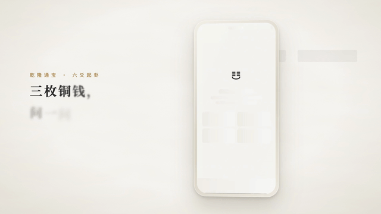
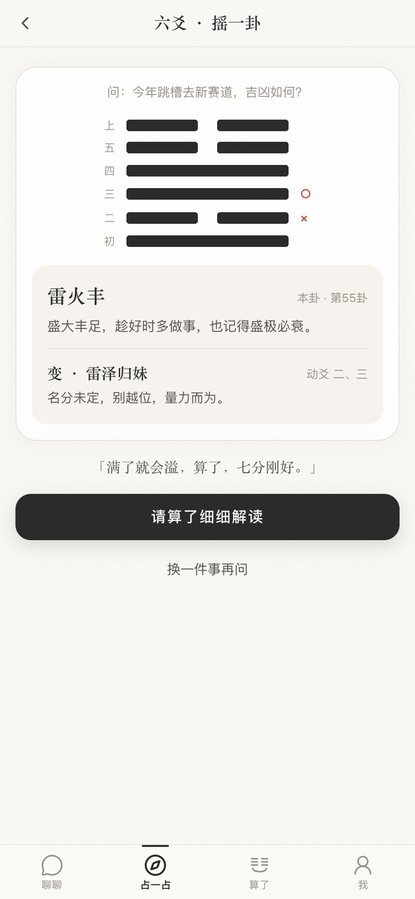
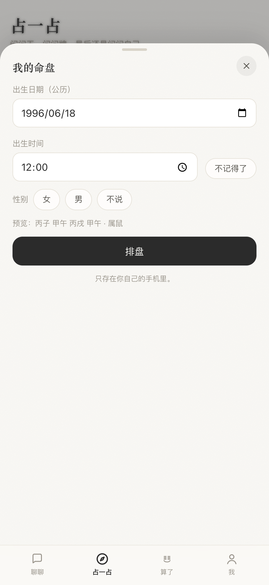
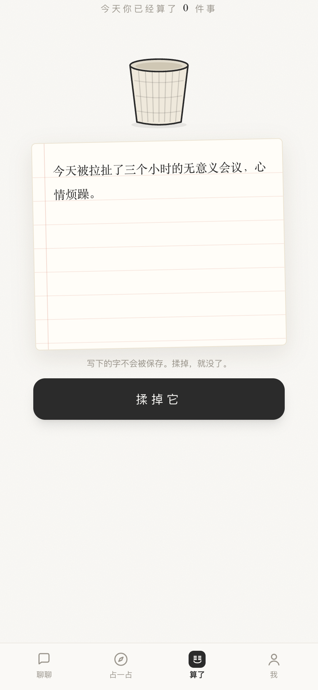
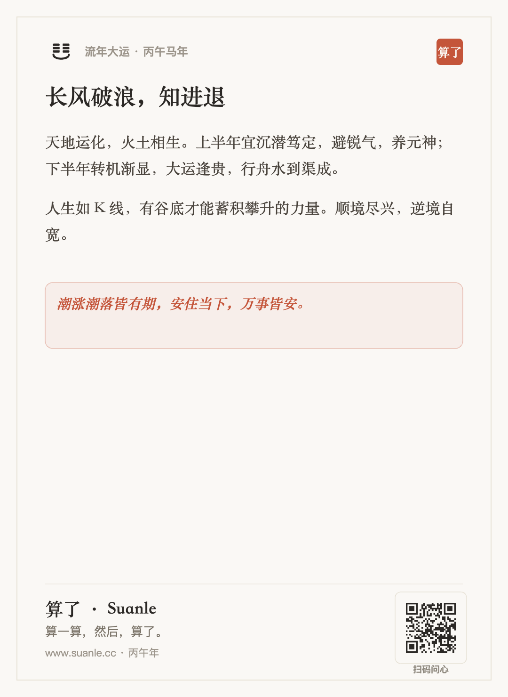
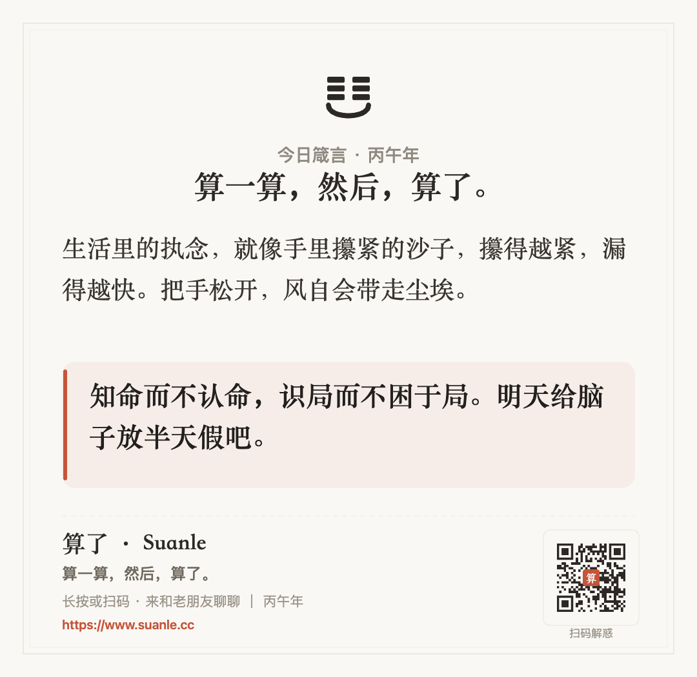

<div align="center">

  

  # 算了 · Suanle

  **算一算，然后，算了。**

  *基于 Next.js 16、PostgreSQL 16 (Drizzle ORM) 与流式大语言模型的沉浸式 AI 互动决策、历法排盘与反内耗 Web 应用*  
  *An interactive decision-making, calendar calculation, and mindfulness web application powered by Next.js 16 and modern LLMs.*

  <p>
    <a href="https://www.suanle.cc"></a>
    <a href="./LICENSE"></a>
    
    
    
    
  </p>

  <p>
    <a href="https://github.com/Evan-Joseph/suanle/releases/download/v1.0.0/suanle_promo_opus55_1080p60.mp4">
      
    </a>
    <br>
    <sub>1080p 60fps 品牌宣传片 (Remotion 4 代码渲染)：<a href="https://github.com/Evan-Joseph/suanle/releases/download/v1.0.0/suanle_promo_opus55_1080p60.mp4">🎬 版本 A：Opus 5.5 版 (45s)</a> · <a href="https://github.com/Evan-Joseph/suanle/releases/download/v1.0.0/suanle_promo_fable51max_1080p60.mp4">🎬 版本 B：Fable 5.1 Max 版 (50s)</a> · 在线体验：<a href="https://www.suanle.cc">https://www.suanle.cc</a></sub>
  </p>

</div>

---

## 1. 产品概览 (Overview)

**算了（Suanle）** 将传统四柱八字、紫微斗数十二宫、六爻铜钱起卦、梅花易数及 78 张韦特塔罗牌阵与流式大语言模型结合，融合荣格心理学投射效应与认知行为疗法（CBT）微行动干预，提供从结构化推演到情绪释放的移动端优先 Web 交互体验。

- **聊聊（内联交互式流式对话）**：主叙事人格「老周（知天命的茶馆掌柜）」基于确定性历法预计算上下文（`chartContext`）进行 SSE 逐字流式推演，通过自定义协议标签动态唤起 6 类内联交互卡片（`coins`、`tarot`、`bazi`、`ziwei`、`almanac`、`letgo`），并通过 `<memo>` 标签静默构建跨会话长期用户记忆画像。
- **占一占（确定性历法排盘与百岁流年曲线）**：基于 `lunar-javascript` 与 `iztro` 引擎在客户端/服务端完成真太阳时天文校准、四柱干支十神、紫微斗数命盘十二宫及 1–100 岁流年运势曲线计算，从源头杜绝大语言模型排盘幻觉。
- **算了（Matter.js 刚体揉纸与 Web Audio 实时声学）**：在宣纸便签上写下执念与烦心事，触发 `Matter.js` 2D 物理引擎纸张揉团与抛入竹篓动效；配合零外部音频资源的 `Web Audio API` 实时合成揉纸白噪声滤波、432Hz 颂钵拍频与 196Hz/588Hz 双泛音铜磬衰减声场，阅后即焚。
- **宣纸木版水印卡片与无感换机同步**：支持将流年判词、卦象问答、今日箴言与释怀信笺一键导出为高清宣纸卡片；采用 `localStorage` 与 `IndexedDB`（`idb-keyval`）双轨互锁自愈存储，并提供一次性 6 位同步码（`SL-XXXXXX`）跨设备幂等合并与身份缝合（Identity Stitching）。

---

## 2. 动态交互与界面预览 (Visual Showcase)

### 2.1 六爻摇卦、百岁流年曲线与“算了”揉纸流程

| 六爻古钱起卦与人生百岁流年推演 (`640×360`) | 便签揉纸入篓与宣纸分享卡生成 (`640×360`) |
| :---: | :---: |
|  |  |

### 2.2 移动端核心视图 (`860×1864` 2x Retina)

| 六爻铜钱摇卦与本卦/变卦生成 | 四柱八字排盘与十神/大运拆解 |
| :---: | :---: |
|  |  |
| **人生百岁大运流年趋势图** | **“算了”宣纸便签书写与揉纸团交互** |
|  |  |

### 2.3 宣纸木版水印分享卡片 (`1080×1128` / `1080×1050`)

| 流年大运判词卡 | 今日箴言宣纸卡 |
| :---: | :---: |
|  |  |

---

## 3. 技术架构与目录结构 (Architecture & Layout)

| 层次 | 核心技术 | 工程实现要点 |
|---|---|---|
| **前端基座** | Next.js 16.2 (App Router) + React 19.2 | Turbopack 构建、服务端流式响应 (SSE) 与 `<think>` 思维链物理隔离折叠 |
| **类型与状态** | TypeScript 5.9 + Zustand 5 + idb-keyval | `localStorage` ↔ `IndexedDB` 双轨互锁自愈，防止移动端 WebView 清理丢档 |
| **历法与命理引擎** | `lunar-javascript` 1.7 + `iztro` 2.6 | 真太阳时经度校准、节气交脱、四柱八字、紫微十二宫与六十四卦纳甲确定性计算 |
| **声学与物理动效** | Web Audio API + Matter.js + Motion 14 | 零外部音频依赖合成器（颂钵/铜磬/古钱碰撞/木鱼/揉纸）与 2D 刚体抛掷仿真 |
| **持久层与云同步** | PostgreSQL 16 + Drizzle ORM | 匿名永久指纹、一次性短码换机幂等合并、虎皮椒支付闭环与 `/curator` 实时监控驾驶舱 |
| **可编程视频工程** | Remotion 4 | `promo/` 与 `works/` 内置代码驱动的 1080p 60fps 品牌宣传片工程 |

```text
suanle/
├── src/
│   ├── app/
│   │   ├── page.tsx                  # 四栏主工作台 (聊聊 / 占一占 / 算了 / 我)
│   │   ├── curator/                  # 主理人实时监控驾驶舱 (硬件探针、流式审计、全量会话检视)
│   │   └── api/                      # 流式对话 (chat)、云端换机同步 (backup)、鉴权与支付接口
│   ├── components/
│   │   ├── ChatView.tsx              # 流式对话引擎、内联工具卡片调度与渐进式建档
│   │   ├── DivinationView.tsx        # 四柱八字、紫微斗数、百岁流年、六爻与塔罗综合排盘台
│   │   ├── LetGoView.tsx             # Matter.js 2D 物理揉纸抛掷与呼吸减压画布
│   │   └── ShareCardModal.tsx        # 四种版式宣纸木版水印卡片预览与高清导出
│   ├── db/
│   │   ├── index.ts                  # PostgreSQL 连接池初始化
│   │   └── schema.ts                 # 用户、会话、排盘档案、云备份、订单与设置表定义
│   └── lib/
│       ├── bazi.ts / ziwei.ts        # 确定性八字、紫微斗数与真太阳时校准引擎
│       ├── annual.ts                 # 百岁流年运势曲线计算引擎
│       ├── sound.ts                  # Web Audio API 铜磬、颂钵、古钱碰撞与揉纸声学合成器
│       └── storage.ts                # localStorage + IndexedDB 双轨互锁自愈与无损合并
├── assets/                           # 品牌徽标、宣传片封面与高清交互动图 (GIF)
├── public/promo/                     # 界面 Retina 截图、宣纸分享卡样张与二维码资产
├── promo/                            # Remotion 1080p 60fps 品牌宣传片工程源码
├── works/                            # 多模型多技术栈原型演进矩阵 (9 套竞争原型与视频工程)
├── Dockerfile                        # 多阶段生产容器构建配置
└── docker-compose.yml                # PostgreSQL 16 + Next.js + Caddy 2 生产编排
```

---

## 4. 快速上手 (Quick Start)

### 4.1 本地开发启动

项目内置完整的离线交互回退逻辑，无需配置远程大模型 API Key 即可启动本地完整界面与排盘体验：

```bash
# 1. 克隆仓库并安装依赖
git clone https://github.com/Evan-Joseph/suanle.git
cd suanle
pnpm install

# 2. (可选) 复制环境变量模板并配置 PostgreSQL 与兼容 OpenAI 协议的模型端点
cp .env.example .env.local

# 3. 启动开发服务器
pnpm dev
```

浏览器访问 [http://localhost:3000](http://localhost:3000) 即可体验。

### 4.2 Docker 生产容器化部署

```bash
docker compose up -d --build
```

---

## 5. 知识产权与许可协议 (License)

本项目遵循专有的 **《算了 · Suanle 源码可用与商业保护协议》(SSACPL)**：
- **个人与学术研究**：允许个人开发者出于技术研究、学术交流与本地非商业目的克隆、学习与调试代码；
- **商业保护限制**：严禁未经书面许可将本项目源码、提示词（Prompt）架构与设计资产用于商业 SaaS 运营、打包转售或收费套壳服务；
- 完整条款详见仓库根目录 [LICENSE](./LICENSE)。
