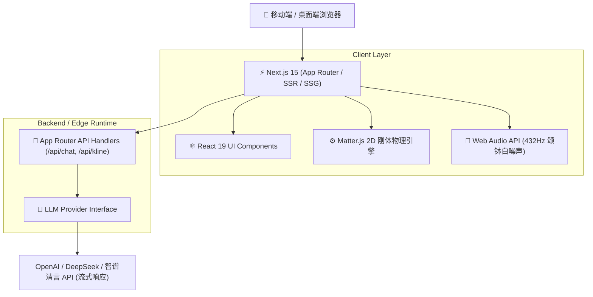

<p align="center">
  <a href="https://github.com/Evan-Joseph/suanle">
    
  </a>
</p>

<h1 align="center">算了 · Suanle</h1>

<p align="center">
  <b>基于 Next.js 15 与大语言模型的沉浸式 AI 互动决策与解压 Web 应用</b><br>
  An Interactive AI Divination, Emotional Release, and Decision-Making Web App powered by Next.js and LLMs
</p>

<p align="center">
  
  
  
  
  
  
  
</p>

---

## 🎬 动态交互演示 (Live Demo Preview)

<p align="center">
  
  
</p>

<p align="center">
  <i>左图：移动端沉浸式转场与功能漫游 | 右图：WebGL 掷钱起卦与物理刚体碰撞</i>
</p>

---

## 🌟 核心特性与功能画廊 (Feature Showcase)

| 🪙 铜钱起卦与六爻推演 | 📈 人生 K 线运势推演 |
| :---: | :---: |
|  |  |
| **真实 2D/3D 刚体动力学**：模拟传统三枚铜钱掷出与正反判定，自动生成本卦与变卦爻辞。 | **多时间尺度量化折线**：基于大语言模型结构化输出，绘制情绪能量与运势波动走向。 |

| 🍃 物理重力小球解压 | 💬 命理顾问多轮深度对话 |
| :---: | :---: |
|  |  |
| **Matter.js 动力学引擎**：倾斜设备或拖拽小球撞击沉浸音阶，搭配 432Hz 颂钵音频抚慰焦虑。 | **流式交互与语境对齐**：支持多轮追问，融入中国传统哲学智慧与现代化心理疗愈建议。 |

<details>
<summary>📇 <b>点击展开查看：生成的个性化年鉴与艺术卡片 (Click to view generated cards)</b></summary>
<br>
<p align="center">
  
  
</p>
</details>

---

## 🏛️ 系统架构 (Architecture)



---

## 🛠️ 技术栈清单 (Tech Stack)

- **核心框架**：Next.js 15 (App Router) + React 19 + TypeScript
- **样式与微交互**：Tailwind CSS + Framer Motion
- **物理与音效**：Matter.js (2D 物理刚体碰撞) + 原生 Web Audio API (432Hz 合成音)
- **大模型生态**：AI SDK / OpenAI 兼容协议流式接口接入
- **开发与构建**：Turbopack / Vite

---

## 📦 项目目录结构 (Directory Layout)

```text
suanle/
├── assets/                  # 演示动图、Logo 与各模块截图
│   ├── demo_home.gif        # 移动端主界面全流程演示
│   ├── demo_coins.gif       # 铜钱物理碰撞动图
│   └── screenshots/         # 4 大核心模块高清预览
├── src/
│   ├── app/                 # Next.js App Router 路由与服务端组件
│   ├── components/          # 物理沙箱、起卦动效、K线图表组件
│   ├── lib/                 # 物理引擎集成、音频管理、LLM Prompt 模板
│   └── types/               # 领域模型与 TypeScript 定义
├── public/                  # 静态资源与音频切片
└── tailwind.config.ts       # 东方美学色彩与字体配置
```

---

## 🚀 快速开始 (Quickstart)

### 1. 环境准备
确保已安装 [Node.js](https://nodejs.org/) (>= 18.18.0) 及包管理器。

### 2. 克隆与安装依赖
```bash
git clone https://github.com/Evan-Joseph/suanle.git
cd suanle
npm install
# 或使用 pnpm
pnpm install
```

### 3. 配置环境变量
复制环境变量配置：
```bash
cp .env.example .env.local
```

按需填入你的大模型 API 密钥（支持 OpenAI, DeepSeek, 智谱等兼容接口）：
```env
OPENAI_API_KEY=your_api_key_here
OPENAI_BASE_URL=https://api.openai.com/v1
```

### 4. 启动本地开发服务
```bash
npm run dev
```

在浏览器打开 `http://localhost:3000` 即可体验。

---

## 📄 开源许可证 (License)

本项目采用 [MIT License](LICENSE) 开源。
